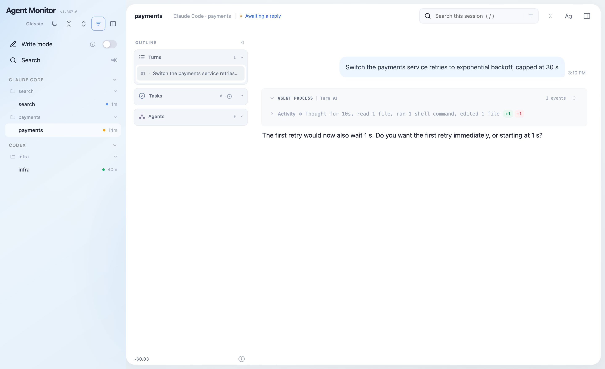

# agent-monitor

Every coding-agent session on this machine on one web page. Sessions from Claude Code,
Codex, Qoder, QoderWork and Qwenwork sit in one tree, so you see at a glance **who is
running, who is waiting for you and why it stopped**; open one to see what that agent is
doing, and from a paired phone follow them all and reply to the one that is waiting.

Reading sessions only reads: it opens the transcripts each agent already writes to disk,
installs no hooks, changes no commands, and serves on the loopback address; closing it leaves
those agents running as before. Writing to a session (write mode, Codex native mode) is
separate, and needs a paired monitor and a switch you turn on.



<sub>Synthetic demo data from <code>docs/demo/make_store.py</code>; no real session.</sub>

## Quick start

```bash
brew install tanghong123/tap/agent-monitor
agent-monitor            # serves http://127.0.0.1:2727 and opens it in your browser
```

macOS and Linux, x86_64 and arm64. `--agents claude,codex` narrows the tree, `--port N` picks
another port, and `--no-open` prints the address instead of opening a browser. The page lists
this machine's sessions by agent, then by project. By default it shows the recently active
and the blocked ones.

## Why it exists

- **Several kinds of agent, and no one place to look.** A TUI in a terminal, headless jobs in
  the background and a desktop app each have their own interface. agent-monitor puts them in
  one tree and marks which session is active, which is blocked and waiting for you, and why
  it stopped.
- **Close a window and that stretch of work is gone.** agent-monitor reads the record each
  agent writes to disk itself, so a session whose window is closed still opens and reads.
- **A dense record you can neither read back nor search.** Each agent's interface is built
  for generating onward, not for going back. agent-monitor opens a session to read, with an
  outline by turn, task and sub-agent, and a search that takes you to the line.

## What it does

- **Who is waiting for you.** Each session is *active*, *blocked* or *idle*, and a blocked
  one carries its reason (awaiting your permission, for example). The filter offers recently
  active, blocked, idle, and hidden sessions. The tree groups sessions by agent, then by
  project; One list by activity in the filter menu shows them as one list ordered by
  activity instead, and remembers the choice.
- **Passive observation.** No hook, no plugin and no special way to start an agent: it reads
  the session files each agent already writes and recognizes running agents from the process
  list, so a session started in a terminal, in the background or in a desktop app appears as
  it is.
- **Read a session.** The outline beside the record lists its turns, tasks and sub-agents.
  Choose a turn to jump to it, open a task's card, or descend into a sub-agent's own record.
  Once you scroll the Turns list yourself, new records leave it where you put it; scrolling
  the transcript, choosing a turn or jumping to the end resumes following.
- **Built for long sessions.** A session reads as one continuous transcript, never paged: the
  page renders only what is near the viewport, and a large session opens on its latest
  512 KB while the earlier turns load behind it. Every turn is numbered, and the title bar
  shows which one you are reading. A turn's tool calls and thinking fold into one
  agent-process block, each step expandable on its own or all at once. A streaming parser and
  a validated cache let sessions of hundreds of megabytes open in seconds; the cache is the
  monitor's, on the disk of the machine it runs on, so reopening a session, even after a
  restart, parses only what was written since.
- **Fast, precise search.** It searches as you type, across the whole session rather than the
  part on screen: in a 600-turn session of about 8 MB of text, each keystroke updates the
  match count for the whole session in typically about 10 ms (about 20 ms for whole words,
  measured on an Apple M4 Pro); a session with over about 10 MB of text searches on Enter. A
  prefix at the start of the box is a filter grammar: `u` your turns, `a` the agent's
  replies, `t` thinking, `o` tools, and the letters combine (`ua:`); `o(…)` narrows the tools
  (`o(B)` is Bash, `o(Bash,Read)` two tools); `w` matches whole words only; a colon ends the
  prefix, as in `w: tag`.
- **File preview.** A text file a session mentions opens in a preview pane, in the bundled
  mdrev viewer, highlighted by language with numbered lines. An HTML page renders as a
  sandboxed page on a paired monitor, and as text on an unpaired one. Consecutive images form
  one group: click one to open it in the pane, or Open all for the whole group. A finger's
  double-tap zooms in and back to fit; a mouse double-click switches between 1:1 and fit.
- **Keeps the reading context.** A message from another session gets a turn of its own,
  pasted text carries a label, quoted replies read as quotations, and Mermaid diagrams draw
  inline. Truncated Bash output is marked and links to the full output; an Artifact edit
  shows the diff it applied, and a publish lists the files it removed.
- **Phone access.** A phone on your tailnet can read a *paired* monitor (see below). On a
  phone the page is a reader: the session list is a drawer, and the tools float at the foot.
- **Write mode.** On a paired monitor, and only after you turn it on and grant it, you can
  reply to a session that is waiting for you from the page. Typing into a live terminal pane
  takes a grant for that pane, and can also require a passcode set only in a terminal.
- **Codex native mode.** Release binaries include it from 1.400.0: on a paired monitor, turn
  on Write and then Codex native to start or continue Codex conversations through a local
  Codex app-server, with text and images, interrupts, approvals and questions
  ([below](#codex-native-mode--optional-shared-runtime)).
- **One interface, and one going.** The app shell is the default. The classic page and
  `/session` have been deprecated since 1.376.0; they are still there, and a button on the
  page switches between the two and remembers the choice.

## Pairing, phone and write mode

```bash
agent-monitor --pair           # once: mint a 0600 token; the monitor requires it from now on
agent-monitor --pair-phone     # let a phone on your tailnet in: single-use QR code + short code, 5 minutes
agent-monitor --set-passcode   # optional: require a passcode before write mode types into a pane (terminal only)
```

The address carrying the token is printed only to a terminal; logs and pipes get the bare
address. If an unpaired monitor is already running, stop it in its terminal and start it
again with `--pair`. On Linux a local request verified as the same OS user passes without the
token; macOS cannot verify one, so there every request needs it.

Pair the monitor before serving it with `tailscale serve`. On macOS an unpaired monitor
admits any request from the same machine, including one `tailscale serve` relays.
`--pair-phone` refuses an unpaired monitor, finds the `tailscale serve` address (or says how
to set it up), and never shows the token itself. `--port N` names the monitor's port,
`--url ADDRESS` an address you already have, and `--yes` skips the confirmation; it never
changes your Tailscale configuration. An address is trusted for reading files and writing
only when it is private to the tailnet and serves the monitor alone at that name and port:
Funnel, or another application sharing the address, rules it out.

## Compared with

- **Each agent's own session list** lists only its own sessions, in an interface built for
  generating. agent-monitor puts every agent's sessions in one tree, with one set of state
  words, built for reading back and searching.
- **A terminal multiplexer** (tmux, say): a closed pane takes its stretch of work with it.
  agent-monitor reads each agent's own record, so nothing depends on a window staying open.
- **LangSmith-style tracing** is built for services running online, through
  instrumentation. agent-monitor looks at the agent sessions on *this* machine, by reading
  the files they already write.

## Privacy

No usage data is collected. What it derives from transcripts is cached on this machine
(`~/.cache/agent-monitor`, or `$AGENT_MONITOR_CACHE`). The monitor's own process opens
connections only to the loopback address (`127.0.0.1`, or `::1` for a Codex endpoint) or,
for Codex native, an owner-only Unix socket. Other connections come from programs it runs:
`tailscale` (read only, to its local daemon), the bundled `mdrev-cli` and its notification
tools, and a Codex app-server it starts.

Content leaves the machine only if you choose to:
- **A phone.** The page on a phone over your tailnet; secrets in what is sent there can be
  masked.
- **mdrev's shared review.** Used from the detached Markdown tab or the phone's Review sheet,
  it reaches the project's review store and any notification destinations you configured.
- **An mdrev service.** On a machine joined to one, opening a Markdown file from a registered
  repository syncs your personal notes there.

Codex native also receives the text, images and actions you submit. Its action receipts
(status and ids, no conversation text) stay on this machine for 30 days.
`agent-monitor-fleet`, a separate tool, reaches the hosts you configure over SSH.

## Also in this repository

| Binary | What it's for |
|---|---|
| **agent-monitor** | the page above (crate `claude-monitor`) |
| **[agent-replay](#agent-replay--read-one-transcript)** | a read-only terminal and browser viewer for one transcript |
| **[agent-jdi](#agent-jdi--supervise-unattended-runs)** | runs an agent unattended and lets you hand off and take over |
| **[agent-monitor-fleet](#agent-monitor-fleet--several-machines-monitors-on-one-page)** | several machines' monitors on one page |

The repository keeps its original name, `claude-replay`, from when it held only the viewer
for Claude Code.

## agent-replay — read one transcript

An interactive, **read-only** viewer for AI coding-agent session transcripts —
*like `claude --resume`, but you can only read*: scroll, fold, search, and
live-tail. Reads both **Claude Code** (`~/.claude/projects/`) and **Codex**
(`~/.codex/sessions/`) transcripts, auto-detecting each. A Rust + [ratatui](https://ratatui.rs)
TUI that renders a session the way the agent does (assistant text, thinking,
tool calls, `+/-` diffs, markdown, syntect-highlighted code) without ever
continuing or mutating the session.

> Extracted from `claude-toolbox`, the author's private toolbox (its `justdoit/`
> module), where it began life as `claude-peek-v2`. Its bash predecessor,
> `claude-peek`, still ships there.

### Install

**Homebrew** (macOS / Linux) — recommended:

```bash
brew install tanghong123/tap/agent-replay
```

This taps `tanghong123/tap` and puts the `agent-replay` command on your `PATH`
(with `claude-replay` kept as a symlink through the rename transition), so
you can run it from anywhere:

```bash
agent-replay --latest      # open your most recent session
agent-replay --version
```

On macOS and Linux (x86_64 and arm64) this downloads a prebuilt binary — no Rust
toolchain, no compile. Later, `brew upgrade agent-replay` updates it and
`brew uninstall agent-replay` removes it — existing installs under the old
`claude-replay` name upgrade transparently (the tap records the rename).
(Equivalent two-step: `brew tap tanghong123/tap` then `brew install agent-replay`.)

**Prebuilt binary** (no Homebrew, no Rust) — `cargo-binstall` grabs the release
tarball for your platform:

```bash
cargo binstall claude-replay      # crate name unchanged; installs the agent-replay binary
```

Or download an `agent-replay-<target>.tar.gz` from the
[releases page](https://github.com/tanghong123/claude-replay/releases) directly
(static musl builds for Linux; run on any distro).

**From source** (needs a Rust toolchain):

```bash
cargo install --path .          # → ~/.cargo/bin/agent-replay
# or
cargo build --release           # → target/release/agent-replay
```

### Usage

```
agent-replay                                 pick from this dir's sessions (Claude + Codex)
agent-replay <session-id | path/to.jsonl>   render that transcript (agent auto-detected)
agent-replay --latest                        newest session for THIS dir or an ancestor (not the global newest)
agent-replay --agent codex                   only show Codex sessions (or --agent claude)
agent-replay <id|--latest> --dump -          plain text to stdout (no TUI) — for pipes/tests
agent-replay <id|--latest> --dump [stem]     write <stem>.txt + <stem>.ansi (deduced stem if omitted)
agent-replay <id|--latest> --dump --width N  dump at width N (default: terminal width, else 100)
agent-replay <id|--latest> --dump --full     dump with everything expanded (default folds like the TUI)
agent-replay <id|--latest> --dump - --json   the structured block stream, one JSON object per block
agent-replay <path> --dump - --json --cache  the same bytes, resumed from the durable cache — for a
                                               collector that dumps the same sessions every day
agent-replay <id|--latest> --dump-html [stem] export a single self-contained <stem>.html (deduced stem if omitted)
agent-replay <id|--latest> --dump-html -      write the HTML page to stdout (no TUI) — for pipes/tests
agent-replay <id|--latest> --html             open in a browser (no TUI): serves over loopback, follows
                                               the session live, Ctrl-C to stop
agent-replay <id> --no-cache                  skip the durable cache (fold from scratch; also allows
                                               a second LIVE view of a session another instance follows)
```

**Live by default.** The viewer and `--html` always tail — new turns appear as the session
writes them; nothing to pass. Dumps (`--dump`, `--dump-html`, `--dump-all-html`) are always
snapshots. `-f`/`--follow` is accepted and ignored, so old commands keep working.

**The durable cache.** Opening a session writes its folded blocks under
`~/.cache/claude-replay/sessions/`, so opening it again resumes where the last run stopped
instead of re-reading the transcript — on a 100 MB session that is most of the file skipped.
It is validated against the transcript (a rewritten or truncated source rebuilds from
scratch), one writer at a time, and swept after two weeks idle. `--no-cache` opts out.
Dumps never touch it — except a JSON dump given `--cache`, which keeps an entry of its own
(`sessions/json/`) so a daily sweep folds only what each session appended since the last one.

**Multi-agent.** With no argument, the picker merges this directory's sessions from
**every agent** — Claude Code (`~/.claude/projects/`) and Codex
(`~/.codex/sessions/`) — into one list, each row tagged with its agent; one session
opens straight in. The agent for any opened file is auto-detected from its contents,
so an explicit path or `--latest` just works. `--agent claude|codex` filters the
picker/`--latest` to a single agent. (`CODEX_HOME` / `CODEX_SESSIONS_DIR` override
the Codex root.)

`--dump` renders through the same pipeline as the live viewer and applies the same
default fold policy, so its output matches what the TUI shows (add `--full` to expand
every block).

**`--dump-html`** exports a **single self-contained `.html`** — no network, no
external assets — that reproduces the TUI's structure in the browser: folding,
search (`/`), `j/k`/`[ ]` keys, a turn sidebar with scroll-spy, a usage/cost panel,
light/dark themes (persisted), and click-to-copy on the session id and code fences.
It honors the same `--fold`/`--unfold`/`--full` flags, but never caps a body — the
full content is always in the file (grep-able), with long tails hidden behind a
`⋯ N more lines` expander. The page is a fixed shell plus an append-only JSONL block
stream inlined in the file — a self-contained snapshot. To watch a running session,
use `--html`, which serves the same content and follows it live.
Clicking a **file path** in a tool header (`Write`/`Update`/`Read`) opens that file
(`file://`, new tab) — the browser's stand-in for the TUI's reveal-in-Finder;
clicking elsewhere on the header still folds.

**`--html`** is the GUI counterpart to the TUI: it renders the page and **opens it
in your browser** instead of drawing the terminal UI. It serves the page over a
tiny **loopback HTTP server** and prints the `http://127.0.0.1:…` URL (copy it to
open elsewhere); Ctrl-C stops the server. Serving (rather than a bare `file://`
page) is what lets a click on a tool-header path **reveal the file in Finder** —
the browser can't shell out, so the click asks the local server, which does the
same `open -R` the TUI does. The page **follows the session live** — new turns
stream in and the cost updates as they land.

When you give **no** session and this directory has **several**, `--html` keeps the
session picker on screen and serves *every* discovered session at once on the one
port. `Enter` — or a click on a row — opens that session in a browser tab and the
list **stays up**, marking what you've already opened (`●`), so you can fan several
sessions out and keep going; `Esc` quits. They are all live simultaneously — each
open tab tails its own session. A directory with exactly one match still opens it
directly.

Default view: user turns (`❯`), assistant text (`⏺`), `✻` thinking summaries, and
code-**modifying** actions (Edit/Write/MultiEdit + mutating Bash) with each edit as
a red/green `-`/`+` diff. Non-modifying ops and tool output are hidden to stay
skimmable; reveal with `--reads`, `--results`, `-v`/`--full`. Per-type fold control
via `--fold`/`--unfold` (`user, assistant, thinking, read, bash, edit, write, tool,
tool_result, command`).

#### Keys
`j`/`k` line · `C-d`/`C-u` half-page · `PageDown`/`PageUp` page · `g`/`G` top/bottom ·
`Space` toggle the focused/first-visible fold (`Enter` toggles the focused one) ·
`T` toggle all · `]`/`[` next/prev foldable · `/` search, `n`/`N` next/prev ·
`?` help · `q` quit. When launched from the session picker (more than one session),
`Esc` returns to that list to pick another; otherwise `Esc` quits too. After
`--latest`, `s` opens the session switcher (a picker overlay) so you can hop to
another session — `Enter` switches, `Esc` returns to where you were.

**Mouse.** Scroll-wheel scrolls; click a block to toggle its fold; click the **path**
in a file tool's header (`⏺ Write(…)`, `Update(…)`, `Read(…)`) to reveal that file in
your OS file manager; drag to select text (auto-copied to the clipboard, or an OSC 52
escape over SSH). A `Write` folds to a 10-line numbered preview and expands to the
whole file, and consecutive tool calls coalesce into one activity line — matching
Claude Code.

## `agent-jdi` — supervise unattended runs

The repo also ships a second binary, **`agent-jdi`**: it runs an AI agent
*unattended* (relaunching on recoverable exits) and follows it live with the
viewer. It's multi-agent and **auto-detects** the agent from the directory's
sessions (Claude or Codex), so one tool covers both.

```bash
agent-jdi start "refactor the parser and add tests"   # fresh unattended run (prints a summary; -f to watch live)
agent-jdi resume            # resume this dir's newest session, unattended (prints a summary; -f to watch live)
agent-jdi resume --id <slot>     # resume an exact tracked slot from `agent-jdi list`
agent-jdi resume --session <id>  # resume an exact session (skips discovery + the stale-session prompt)
agent-jdi resume --agent codex   # force an agent
agent-jdi handoff "finish the refactor and commit"    # hand THIS interactive session to an unattended run
agent-jdi log               # reattach the viewer to the supervised session
agent-jdi status            # rich status: live progress, task checklist, recent commits, start/finish
agent-jdi backlog "also update the changelog"   # queue follow-up; a live run drains it when its work finishes
agent-jdi backlog --drain   # drain the queue now (relaunches a stopped session)
agent-jdi takeover          # stop the run and hand it back to you (launches the resumed agent)
agent-jdi list
```

`start` runs a **fresh** task (vs. `resume`, which continues an existing session).
The session id is pinned up front for Claude (`--session-id`) and **captured** for
Codex (which assigns its own id — recovered after the first turn via a nonce). With
no `--agent`, `start` reuses the agent of the **latest run in this directory** (its
last `agent-jdi` run, else the most recent session of any kind), defaulting to Claude
only when the directory has no history.

By default `start`/`resume` launch the worker **detached in the background** and
print a summary (session, retry policy, autonomy, follow-up commands), then return —
add **`-f`/`--follow`** to open the live viewer instead (equivalent to running
`agent-jdi log <id>` afterward).

**Handing sessions across the human ↔ jdi boundary.** `takeover` and `handoff` are
mirrors: `takeover` stops an unattended run and **launches the agent interactively
resumed** on the session so you continue it yourself (`--no-launch` to just stop and
print the resume commands); `handoff`, run from *inside* an interactive session,
hands it the other way — it quits your session and resumes it unattended in the
background (`--armed` to arm without auto-quitting). The shared `jdi-handoff`
Skill wraps this flow for both clients: use `$jdi-handoff` in Codex or the native
`/jdi-handoff` command in Claude Code. Install and usage details are in
[`integrations/`](integrations/).

`takeover` resumes with the run's **unattended posture** (Claude's
`--dangerously-skip-permissions`) so it doesn't start prompting on every action;
`--supervised` resumes with approvals on instead. With **no agent-jdi run tracked**
for the directory it takes over the newest *unmanaged* claude/codex session there:
if another agent is already live on that session it refuses and prints the resume
command, unless `--force`, which kills that agent first.

Any command that would affect a real agent (`start`/`resume`/`backlog`/`takeover`/
`handoff`) accepts **`--dry-run`** — it prints exactly what it would do (agent,
resolved binary, the full invocation, what it would kill/queue) and exits with
**no** spawn, kill, or state change. Use it to verify before committing to a real run.

Install: `brew install tanghong123/tap/agent-jdi` (depends on the viewer formula).
It uses its own state under `~/.local/state/agent-jdi/` (`$XDG_STATE_HOME`; override
the whole path with `AGENT_JDI_HOME`) — not under `~/.claude`, since it's agent-neutral. It
supersedes the bash `claude-jdi` from `claude-toolbox`. The two enforce **one
supervisor per directory**: each refuses to `start`/`resume` a directory the other
is already live in (stop the other first, or use it).

Architecture: an **agent-agnostic supervisor spine** (detached worker, slot lock,
`meta` state, backlog queue, retry loop) drives per-agent **`AgentAdapter`s**
(`src/jdi/{claude,codex}.rs`). Adding an agent is one module + one registry arm;
adapters may leave optional capabilities (e.g. a native task queue) unimplemented.
See [`src/jdi/DESIGN.md`](src/jdi/DESIGN.md).

Codex integration is validated against CLI 0.145.0: authentication uses
`codex login status`, unattended turns use `codex exec` / `codex exec resume`,
interactive takeover uses `codex resume`, and fresh-run identity is read from the
JSON `thread.started.thread_id` event (with rollout-marker discovery as a fallback).

## Codex native mode — optional shared runtime

Release binaries include native Codex controls from 1.400.0; a source build needs
`--features codex-native`.
The ordinary reader and Claude writer stay unchanged until you enable Write and
then Codex native. Only `agent-monitor` integrates this mode; retiring monitor
entrypoints receive no native extension.

```sh
cargo build --release -p claude-monitor --features codex-native
agent-monitor --pair --no-open --codex-allowed-root /path/to/project
```

The default is `ws://127.0.0.1:4500` with Monitor's independent capability token.
Codex App cannot directly share this endpoint unless its local connection can
supply the required Bearer header; an endpoint override alone is insufficient.
App sharing is an explicit Unix option on macOS and Linux. `unix://` selects
`$CODEX_HOME/app-server-control/app-server-control.sock`, and
`unix:///absolute/path.sock` selects a different socket. Monitor uses WebSocket
frames over that private Unix socket. Each connection verifies the socket and
physical parent are owner-only, validates any rendezvous alias, and checks the
server's OS user. This option trusts every program running as that OS user;
it does not authenticate a particular executable or create a native Bearer token.

Use `--codex-server-url unix://` to choose Unix sharing explicitly. CLI options take
precedence over `CODEX_NATIVE_SERVER_URL`; either explicit configuration overrides
the token-authenticated WebSocket default. WebSocket requires capability-token authentication, including
on reconnect. There is no automatic fallback to WebSocket if Unix fails.
The HTTP gateway is retained in both modes: browsers and phones still
use Monitor's paired HTTP API, not the native socket or native Bearer credential.

Install the Codex CLI and make `codex` available on PATH, or explicitly set
`CODEX_NATIVE_BINARY`. The server uses `CODEX_HOME` (normally the Codex CLI's own
home). Configuring the endpoint does not start a process or silently enable
pairing. The **Codex native** switch starts or connects to the selected server;
its menu stays open to show the resulting connection status.
Native controls include projects, models, effort, speed, history, text/images,
queue steering, interrupt, approvals, and questions. Ordinary Claude sessions
retain their existing controls and transport.

**Turn off native mode** releases Monitor's session connections without waiting
for background reads or active sessions to become idle. If this Monitor started
`codex app-server`, it stops and reaps that process and its running work; connected
Codex apps disconnect too. Turning off Native, or Write while Native is enabled,
asks for confirmation before stopping a Monitor-owned server. The confirmation
names known running turns. Active or pending work also requires confirmation
before detaching from an external server, whose turns continue running. Cancel
keeps both modes on. An idle external server detaches without confirmation. History
and already delivered messages are retained; closing the mode never retries them.
Paired clients can share live sessions through this server.

If a session is open in another Codex server, its history stays readable. The
composer shows **Session open elsewhere**, with **Try again** and **How to resolve**.
Finish the current turn and quit the owning App instance or CLI session, then
retry. Monitor does not stop other processes or send the draft during recovery.
To keep using App and Monitor together, the help panel includes a short setup
prompt with the actual endpoint, configured Codex home and authentication method.
Unix sharing requires an App version and configuration that select that same
socket; starting the App alone does not prove sharing, because it may fall back
to its own stdio server. App-sharing setup appears only after choosing Unix;
no native token or token-file path appears in a setup prompt. The prompt asks
the coding agent to inspect the local
installation and prepare a one-line terminal command or a local launcher with
a one-line invocation. The agent must not execute it or stop its own App/server.
The user saves their work, runs the command outside Codex, and confirms any restart;
the launcher must preserve unrelated instances and verify the shared connection.
Monitor does not launch or reconfigure the App itself.

The CLI must support the selected `app-server --listen` transport. Monitor can
connect to an existing private native daemon or explicitly start a foreground
listener with the same endpoint. It preserves independently managed daemons and
does not run `daemon stop`. Invalid socket entries fail closed; Monitor never
deletes or changes permissions on an existing socket to force attachment.

Open `/codex-workspace` for the same app shell on desktop or phone. Its manifest
scope includes `/pair`, so a Home Screen app can pair in its own browser storage.
See [the native permission model](design/codex-native-permissions.md) for the
capabilities and policy inherited from Codex.

Native Node tests run through `cargo test` and CI. Real Chrome cases live in
`claude-replay-browser-tests` and use the repository's hermetic Monitor/Stores/
phone harness; no private App runtime is required.

## `agent-monitor-fleet` — several machines' monitors on one page

The workspace also builds **`agent-monitor`**: one loopback page showing every agent
session on *this* machine. It is single-machine on purpose and stays that way —
**`agent-monitor-fleet`** is a separate binary that opens one SSH tunnel per machine
and serves a switcher whose tabs are those monitors' own pages, unmodified, in iframes.

```bash
cargo install --path claude-monitor   # → ~/.cargo/bin/agent-monitor
agent-monitor                         # opens the app-shell monitor at 127.0.0.1:2727
```

Two interfaces ship, and both are supported. The **app shell** is the default: it consumes the
structured session index and the `/records` pipeline directly, in one document. The **classic**
rail-and-iframe page is still there. Each carries a button that switches to the other and
remembers the choice; `?ui=classic` or `?ui=app` on the URL overrides for a single request
without changing what is remembered, so the two can be compared side by side. The classic page
stays until the app shell has been validated in real use.

```bash
cargo install --path claude-monitor-fleet   # → ~/.cargo/bin/agent-monitor-fleet
agent-monitor-fleet discover --add         # find the monitors you have, and keep them
agent-monitor-fleet up                     # tunnels + the page, opened in your browser
```

That is the whole first run. `discover` without `--add` probes and writes nothing, and
`up --discover` uses what it finds once without saving — either is a way to look before
anything lands in the config.

```bash
agent-monitor-fleet up [--port N] [--no-open] [--discover]
agent-monitor-fleet discover [--add] [--host DEST]... [--ssh-config PATH]
agent-monitor-fleet status     # probe the configured environments; open nothing
agent-monitor-fleet list       # what is in the config
agent-monitor-fleet add NAME [--ssh DEST] [--ssh-option ARG]... [--cache-root PATH] [--port N]
agent-monitor-fleet remove NAME
```

**Nothing about your machines is assumed.** The config — `$CLAUDE_MONITOR_FLEET_CONFIG`,
else `fleet.json` under `$XDG_CONFIG_HOME`/`~/.config` in `claude-monitor/` when that
directory already exists (pre-rename installs) or `agent-monitor/` otherwise — is a
JSON file you can edit, and it **ships
empty**: every host in it is one you or discovery put there. Each monitor's port is
**read from that monitor's own lock** (`<cache root>/LOCK`), so one on a non-default
`--port`, or a second one under its own `$CLAUDE_MONITOR_CACHE`, is found as it is; local
tunnel ports are allocated by the kernel, so nothing collides with what you already run.
`add NAME` with no `--ssh` means this machine; `--cache-root` says *which* monitor on a
machine that runs two, and `--port` pins one whose lock can't be read.

**Discovery** probes this machine and every literal `Host` in *your* SSH config, in
parallel, with `ssh BatchMode` — a host that would ask for a passphrase is skipped rather
than left hanging (load the key into an agent, or `add` that host, where prompts work).
Two `Host` aliases for one machine collapse into one environment, and a host with no
monitor is reported as exactly that instead of being filled in.

**`up`** brings environments up one at a time, since a host-key or passphrase prompt needs
the terminal to itself, and one that doesn't answer is **skipped with the reason** rather
than costing you the others. It prints the URL on stdout — `--no-open` leaves the browser
alone, `--port N` pins the page's own port instead of letting the kernel choose — and holds
the tunnels for as long as it runs, taking them down when it stops, on `Ctrl-C` or `kill`
alike. **A tunnel that drops is re-opened**: a laptop lid, a changed network or a timed-out
connection costs that one tab a few seconds instead of costing it the rest of the run — with
backoff for a host that stays away, and on the same local port whenever it is still free, so
the tab follows its machine by itself. A *monitor* that is down is still only reported; the
fleet starts nothing on your machines. On the page, `1`–`9` pick a tab, `[` / `]` cycle, `r`
reloads the visible one, the URL fragment names the current machine so a bookmark points at
it, and the dot beside each name is health this process polls (the tabs are cross-origin, so
the browser can't ask them anything — this process can).

One prompt is enough if you'd rather ask an agent: install the Skill with
`./integrations/install-skill.sh monitor-fleet`, then `/monitor-fleet` in Claude Code or
`$monitor-fleet` in Codex — see [`integrations/`](integrations/). Why this is a companion
binary instead of a flag on the monitor is in
[`design/monitor-fleet.md`](design/monitor-fleet.md).

## Develop

It is **fully testable headless (no TTY)** — see [`CLAUDE.md`](CLAUDE.md).

```bash
cargo fmt --check
cargo clippy --all-targets
cargo test                                  # deterministic; no terminal needed
cargo test --test tmux_smoke -- --ignored   # opt-in end-to-end via private tmux
```

### Developer docs

> **Hosted:** [architecture](https://tanghong123.github.io/claude-replay/architecture.html) ·
> [developer guide](https://tanghong123.github.io/claude-replay/developer-guide.html) ·
> [API reference](https://tanghong123.github.io/claude-replay/) — rebuilt on every push.

- **[docs/architecture.md](docs/architecture.md)** — the system design: the three-layer
  engine (decode → fold → present), the two-crate boundary, the data model, and the
  per-agent `TranscriptAdapter` seam. (Also as a standalone graphics-rich page:
  [docs/architecture.html](docs/architecture.html) — open locally / host it.)
- **[docs/developer-guide.md](docs/developer-guide.md)** — build & test (incl. headless TUI
  testing and the byte-identical gate), using the engine as a library, and a step-by-step
  **[add-an-agent walkthrough](docs/developer-guide.md#4-adding-an-agent)**.
- **[docs/agent-monitor-deck.html](docs/agent-monitor-deck.html)** — an overview deck of
  `agent-monitor` and the reusable modules it offers (14 slides; ←/→ to navigate); also in
  Chinese: [docs/agent-monitor-deck.zh.html](docs/agent-monitor-deck.zh.html). Both are
  generated from one template, so they never drift apart.
- **[docs/adapter-rendering-validation.md](docs/adapter-rendering-validation.md)** — the reusable
  synthetic-transcript method for mapping a new agent's native events onto the shared Claude
  vocabulary without adding agent-specific rendering branches.
- **API reference** — auto-generated from the source, so it always matches the code; documents
  every object incl. internal ones (the `TranscriptAdapter` seam, the `Replayer` fold, …), not
  just the public API. Read it locally with `cargo apidoc --open` (alias for `cargo doc
  --workspace --no-deps --document-private-items`), or browse the hosted copy — the
  [`API docs` workflow](.github/workflows/docs.yml) rebuilds and publishes it to GitHub Pages
  on every push to `main`.

### Source layout

A Cargo **workspace** with two crates, split so the parsing engine is reusable and its
agent-neutrality is compiler-enforced:

- **`claude-replay-core/`** — the agent-agnostic engine. Its only dependencies are
  `serde_json` + `anyhow` (no TUI/HTML/CLI), so nothing here can reach into presentation.
  - **Shared engine:** `model.rs` (the `Block` data-model vocabulary + block classification —
    `block_kind`/`fold_key`) · `engine/` (`replay` = the L2 `Replayer`/`Shaping` fold +
    `parse_stream` driver that *builds* blocks · `message` · `session` · `index` · `store` ·
    `path` · `time`) · `metrics.rs` (the `Metrics` value + pricing) · `discover.rs` (the
    `Candidate` type, `detect_agent`, `session_cwd`, `session_id`, `subagent_source`,
    `resolve_any`) · `follow.rs` · `tail.rs` · `agent.rs` · `adapter.rs` (the `TranscriptAdapter`
    trait + registry — the single per-agent seam).
  - **Per-agent adapters** (symmetric — each is Layer 1 only, feeding the shared engine):
    `claude_model.rs` / `codex_model.rs` (tokenizer + `Shaping`), `claude_metrics.rs` /
    `codex_metrics.rs` (token/cost folding), `claude_discover.rs` / `codex_discover.rs`
    (that agent's transcript store). Adding an agent is a new `*_model`/`*_metrics`/
    `*_discover` trio plus one `impl TranscriptAdapter` row in `adapter.rs` — the shared
    engine stays untouched.
- **`claude-replay`** (root crate) — the ratatui viewer + HTML export + clap CLI, plus the
  `agent-jdi` binary. `markdown`/`render`/`wrap`/`view`/`app`/`theme`/`highlight`/`picker` ·
  `html_export/` (`mod`=render core, `bundle`=offline writers, `serve`=live server) ·
  `jdi/` (see [`src/jdi/DESIGN.md`](src/jdi/DESIGN.md)).

The golden visual-parity fixtures **and** the comparison harness live in a separate
private repo, `claude-replay-eval` (they contain real Claude session content and are
kept out of this tree). It holds `golden/cc.scroll.{txt,ansi}` (Claude Code's own
render), `capture-golden.sh` (mint a golden from a session id via real `claude
--resume`), `capture-peek.sh` (drive this viewer), `stitch-frames.py`, and
`compare-scroll.py`. See `DESIGN.md` › "Visual-parity harness".

## Roadmap

- Lazy/viewport-only syntax highlighting (large transcripts open instantly).
- Point `claude-toolbox`'s `claude-jdi` installer at the brewed `claude-replay`
  (with bash `claude-peek` as the fallback).

See [`DESIGN.md`](DESIGN.md) for the phased plan and design notes, and
[`ATTRIBUTION.md`](ATTRIBUTION.md) for borrowed ideas.

## License

MIT
