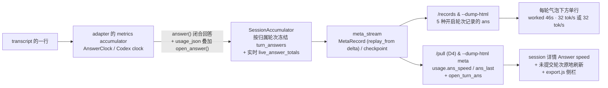
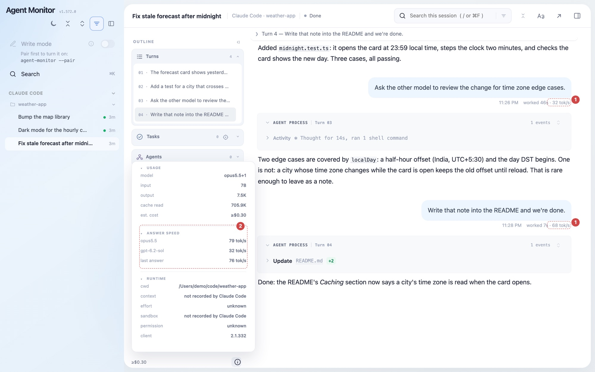
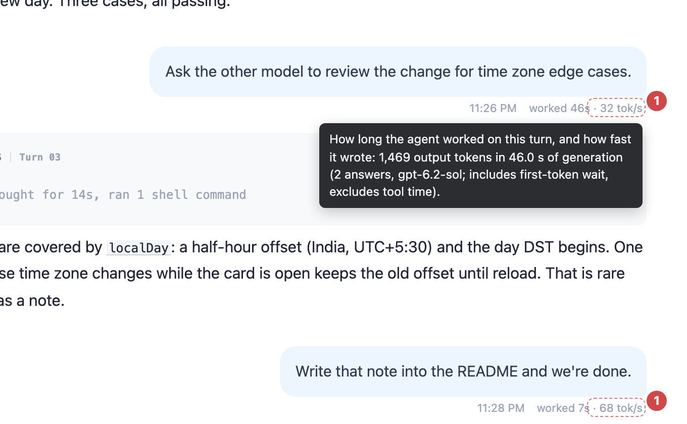
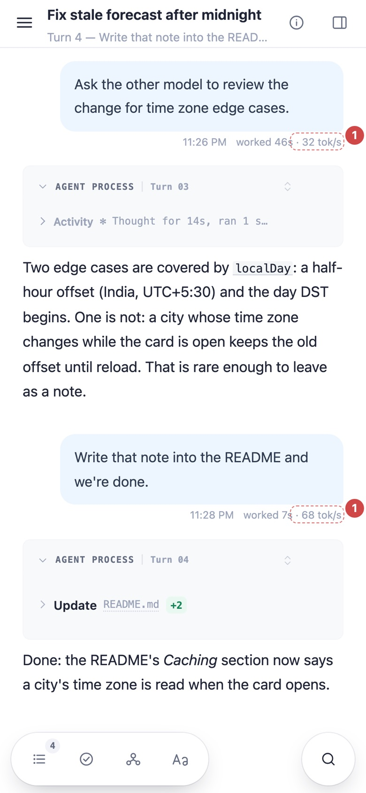
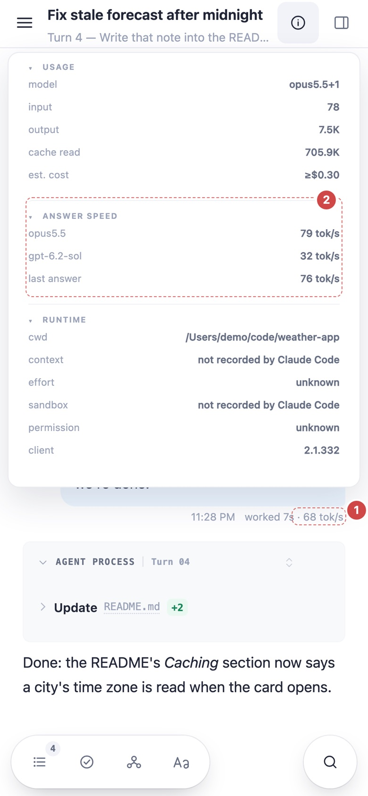

Status: Approved
Owner: Hong

# 在每一轮和每个 session 上显示模型的回答速度

- 版本：v5
- 语言：仅中文版（无对应英文正本）
- 接替关系：无

**建议**：只在每一轮气泡下方（并入已有的“worked 46s”，写作“worked 46s · 32 tok/s”；无耗时 `dur` 时单独显示“32 tok/s”）和 session 详情的“Answer speed”一组中显示模型回答速度；**session 列表不显示，`/api/sessions` 和成本账本都不改**（Hong 已于 2026-11-27 拍板）。两处数据同走打开 session 时的 `SessionAccumulator`（`/records` + `/pull` 的 `meta`），旧 session 也能显示。
**代价**：`FOLD_VERSION` 从 101 升至 102，已缓存的打开过 session 下次打开重算一次；成本账本也依赖该版本，按 `COST_BUDGET_BYTES` 的例行预算分批刷新（1.45 GB 总计约 3 秒）。`cost.rs`、`LEDGER_SHAPE` 和 `/api/sessions` 均不改。离线 `--dump-html` 输出新增字段，字节门禁基线需重做；读数含首个 token 等待时间，短回答会偏低。
**决策状态**：D1 已由 Hong 拍板（仅每轮 + Info 面板）；D2（文案口径与 `export.js` 侧栏细节）按实现阶段默认方案执行；D4（`#s741`，`#s748`）由 Hong 裁定：`/pull` 使用独立可选参数 `meta=<n>` 并在响应返回 `meta_gen`，四段 cursor 保持不变，纯速度变化不重发块。原型见附录 C。

> 第 1–9 节是决策说明；文件、字段和数字的出处都在附录。

## 1. 问题

**一句话**：看 monitor 的人能看到每轮花了多久，但看不出其中模型写字花了多久、写得多快，所以分不清“慢”是模型慢、网关慢，还是工具跑得慢。

例子：一个修 bug 的 session 跑了一下午。前两轮用 Opus，第三轮让它换成经由网关的另一个模型去做评审。第二轮和第三轮页面上都写着“worked 46s”，看起来一样。可这两个 46 秒里，各有多少在跑测试、多少在等模型写字？两种模型谁快？页面上没有答案。要知道，只能自己翻 transcript 一条条减时间戳。更常见的情况是根本没人去算，“今天这个网关是不是变慢了”就一直靠感觉。

## 2. 背景

事实：

1. 每轮气泡下方现在只显示发送时间和总耗时（例如“11:26 PM  worked 46s”，桌面和手机都在气泡下方共享同一行，附录 B.1）。总耗时包括工具运行、权限等待和模型生成三段，分不开。并且只有 Claude adapter 产出每轮耗时 `TurnDuration`，Codex 和 Qoder 系的轮次没有 `dur`，Claude 轮次里也有约 19% 没有 `dur`（附录 B.1）。
2. 引擎已经在给每一次模型请求计时：请求什么时候发出、回答最后一行什么时候写下、写了多少 token。这套计时原本是给 agent-metrics 测生成速度用的，Claude Code、Codex、Qoder 系均已实现，Antigravity 等不计时的 adapter 未覆盖默认返回 `None` 的 `answer()`，monitor 还没用上（附录 B.1）。其中 Claude/Qoder 的 `AnswerClock` 只在**下一条不同 id 的回答到达**时才把上一条放入 `answer()`，当前最后一条留在 `open_answer()` 里；Codex 在收到 `token_count` 时立即从 `answer()` 产出，没有未闭合回答（但 `token_count` 常规不产出新块）。
3. 本机最近 20 个 Claude Code session 实测（附录 B.2）：10,763 次回答都能算出速度。输出 200 token 以上的回答里，Opus 5.5 中位数每秒 85 个 token，同一批 session 里经网关的 gpt-6.2-sol 每秒 32 个；按轮算，1,404 轮里 91% 有读数，中位数每秒 68 个。
4. 实测与引擎既有观察（附录 B.3）：Claude Code 按内容块落盘，单个块生成过程中 transcript 没有中间增量 token；在本机 2.1.332 上探测的 6 次多行回答，各自所有行都在同一次 0.1 秒轮询内落盘，最长一次等待 28 秒期间文件无任何新行。引擎另在 40 份 transcript 中测得 80,752 次回答里有 6,584 次因中途执行工具而在回答两行之间夹着工具结果（`claude-replay-engine/src/metrics.rs:512-515`），但无论哪一种，正在生成中的内容块都不会提前写出实时速度。
5. 打开 session 时，Session 详情里的 `Usage` 和 `Runtime` 两组数据全部来自 `/pull` 返回的 `meta.usage`，而不是 `/api/sessions`（附录 B.1）。

推断：

- 因为第 4 点，从 transcript 得不到“正在生成的这一次回答”的实时速度，只能得到已落盘回答的速度。agent 每隔几秒就调一次工具，通常是不同的回答，因此“最近一次回答”的读数接近实时；同一回答的多行也可能夹着工具结果。
- 因为第 5 点，且 Hong 已拍板不在 session 列表显示，session 级的回答速度直接放进 `meta.usage` 即可，与现有 `Usage` / `Runtime` 同源，无需改成本账本或 `/api/sessions`。

旧决定和约束：页面不能为没有数据的情况编数字。每轮耗时缺数据时就什么也不显示，不显示 0，速度照此办理。

## 3. 目标

**一句话**：看 session 的人一眼就能看出每轮模型写得多快，以及这个 session 里每个模型平均多快，不用自己算。

同一个例子，改完以后：第二轮气泡下方写着“11:22 PM  worked 46s · 84 tok/s”，第三轮写着“11:26 PM  worked 46s · 32 tok/s”。同样是 46 秒，第二轮模型写了 3,065 个 token，第三轮只写了 1,469 个，换上的模型慢了一半多。鼠标停在第三轮上能看到“1,469 output tokens in 46.0 s of generation (2 answers, gpt-6.2-sol; includes first-token wait, excludes tool time between answers)”。在没有 `dur` 的轮次（Codex、Qoder 或缺少 `TurnDuration` 的 Claude 轮次），同一位置直接显示“32 tok/s”。打开 session 详情，“Answer speed”一组列着 `opus5.5 79 tok/s`、`gpt-6.2-sol 32 tok/s`，还有 `last answer 76 tok/s`。慢在哪儿，一眼就清楚。

| 角色 | 之前 | 之后 |
| --- | --- | --- |
| 看 session 的人 | 只看到总耗时，要比较模型得自己翻 transcript 算 | 每轮直接看到速度，session 详情里按模型看到平均值 |
| 换模型或网关的人 | 靠感觉判断新的是否更慢 | 同一个 session 里新旧模型的速度并排列出 |
| 手机上看的人 | 气泡下方单行显示时间与总耗时 | 同上，仍保持气泡下方单行不折行（含 Aa 最大字号档，附录 B.5） |
| 维护者 | 无 | 只扩展打开 session 时的 fold（每轮 `ans` + `meta` 的速度汇总与未提交轮次读数），不动成本账本与 `/api/sessions` |

## 4. 改动范围

- **契约**（均为纯新增可选字段，Contract v1 向后兼容）：
  - 会话记录（`/records`、`/pull` provisional，以及离线 `--dump-html` / `--dump-all-html`）：**全部 5 种开启轮次的记录**（`UserText`、`UserReply`、`UserInbox`、`Command`、`PeerText`）新增可选字段 `ans`（输出 token、生成毫秒数、回答次数、Rust 侧格式化后的模型简称）。
  - 会话元数据（`/pull` 与离线导出页的 `meta`）：`meta.usage` 新增可选字段 `ans_speed`（按展示模型名合并的速度汇总）和 `ans_last`（最近一次有效回答）；`/pull` 的 `meta` 另增可选字段 `open_turn_ans`（未提交窗口内带读数的轮次数组），用于运行中未提交轮次的原地刷新。
  - `/pull` 的 cursor 严格保持 `cursor=<epoch>.<committed>.<gen>.<index>` 四段；独立可选参数 `meta=<n>` 与响应字段 `meta_gen` 跟踪速度读数。省略 `meta` 时视为匹配；不匹配时返回最新 `meta` 且不重发 provisional 块（D4，`#s741`）。
  - **`/api/sessions` 不变**（Hong 已拍板）。
- **实体**：
  - durable cache 的 `meta_stream`（`MetaRecord`、`MaterializedMeta` 及其 `checkpoint`）新增每轮回答汇总 `turn_answers`、按原始模型名单调累计的持久化增量 `MetaRecord.answer_totals`（两次 `replay_from` 快照之差）与 `last_answer`；`checkpoint` 从累加器维护状态独立捕获并省略零值项；升至**下一个 `FOLD_VERSION`**，旧缓存下次打开自动冷重算。
  - 会话级速度汇总（`live_answer_totals` / `live_last_answer` 与 `meta_stream` 持久化字段）只保存在 `SessionAccumulator` 与 `meta_stream` 中，**不加入公开、可序列化的 `Metrics` 结构体**（成本账本的 fold 也构造同一个 `Metrics`）。
  - **成本账本（`CostLedger` / `LEDGER_SHAPE`）不变**。
- **模块**：不加新模块。扩展 `SessionAccumulator`、公开 trait `BlockStore`（`claude-replay-engine/src/engine/session.rs:29` 定义，`claude-replay-engine/src/lib.rs:35` 与 `claude-replay-core/src/lib.rs:42` 重新导出，优先新增带默认实现的方法或参数结构体以保持无损/TUI 存储免改兼容）、`SharedSession`、`html_export/mod.rs`（`assemble_meta`、`usage_json`、`render_blocks`）、`serve.rs`、以及前端 `components.js`、`session-view.js`、`export.js`（同步扩展 `PullClient` 与前端的 `meta=<n>` 回传）；同步更新 `docs/backend-contract.md` 并重做 `scripts/gate/gate.sh` 的 `--dump-html` 字节基线。
- **运维与依赖**：无。

## 5. 可选方案

| 方案 | 怎么做 | 好处 | 代价 | 选或不选的理由 |
| --- | --- | --- | --- | --- |
| 保持现状 | 只显示每轮总耗时 | 不用改 | 问题照旧 | 不选：数据已有，只是没显示 |
| **每轮显示 + session 详情走 `meta.usage`（已定方案）** | 打开 session 时由 `SessionAccumulator` 产出每轮 `ans`、`meta.usage` 里的按模型汇总 + 最近一次回答，以及未提交轮次的 `meta.open_turn_ans`（纯 meta 刷新走 D4 选定方案） | 每轮和 session 同源同口径；不动成本账本、`/api/sessions` 与公开 `Metrics`；常规带块回答靠 `meta` 轻量刷新 | 打开过的 session 缓存需随下一个 `FOLD_VERSION` 重算一次；`--dump-html` 字节门禁需重基线；Codex 纯 `token_count` 刷新走独立 `meta=<n>` / `meta_gen` | **选（Hong 已拍板 D1）**：和现有 `Usage`/`Runtime` 同源，契约面与性能代价最小 |
| 每次回答单独标注 | 每一次模型请求旁边显示速度 | 最细 | 一轮中位数 4 次、最多几十次回答，页面又把多次回答的思考和工具调用合成一块，没有地方放 | 不选：和页面结构对不上 |
| 用每轮总耗时去除 | token 数 ÷ “worked 46s” | 最简单，不用新数据 | 把跑测试、等权限都算成“写得慢”，数字没有意义 | 不选：会误导 |
| 在 session 列表显示（走成本账本 + `/api/sessions`） | 扩展 `MetricsFold`、`CostLedger` 与 `/api/sessions` | 不打开 session 即可在列表看均值 | 改动 `/api/sessions` 公开契约、全机账本冷重算、每 5s 轮询增重 8%–15%、挤压列表宽度 | **不选**：Hong 已拍板不改 `/api/sessions`、列表不显示 |
| 实时速度 | 在 API 请求链路上加代理，边收边数 | 真正的实时 | 要改每台机器上 agent 的网络配置，超出这个仓库的范围 | 不选：transcript 里没有生成中的中间 token，见第 2 节 |

## 6. 风险与退路

- **读数偏低或被误解**：短回答主要时间花在等首个 token 上，API 重试也会拉长时间，读数会偏低。模型的思考不算“等待”：思考产生的 token 计入输出 token，思考的时间也计入生成时间，两边都算，不会把速度拉低（附录 B.2）。桌面悬停说明写清“含首 token 等待、不含回答之间的工具时间”；同一回答两行之间的工具运行仍包含在内，手机没有 hover（D2 已按默认方案实现）。
- **跨轮回答、排队提示（`queue_pin`）与续读一致性**：`meta_stream` 计数器只能累加不能扣减，已提交轮次记录在提交后不可修改，且 `⧗ queued` 标记会 pin 住它所在轮次不提交，使续读点（`boundary.front()`，最老未提交轮次的开启行）早于当前折叠行。方案将**会话级实时累计**、**持久化 `replay_from` 增量**与**按归属轮次冻结**清晰分开：会话级实时累计（`live_answer_totals` / `live_last_answer`）包含**全部已闭合的 `answer()`**（覆盖已提交与未提交轮次）；`MetaRecord.answer_totals` 只是两次 `replay_from` 快照之差（`Boundary` 在 `builder.rs:388` 像 `tokens` 一样捕获）；组装 `usage_json` 时，在实时累计上临时叠加 `open_answer()`（零扣减）。每轮在自己 commit 时只冻结归属该轮的回答（按回答第一行所在轮次归属）；续读点之前轮次均已提交，恢复 `Resume.metrics_state` 后调 `open_answer()` 即可确定需在未提交轮次中跳过的旧轮未闭合回答 id，确保含排队提示时冷折叠与续读仍逐字段一致（详见附录 A.3、A.4）。
- **Codex 无块 `token_count` 行与 `/pull` 刷新（D4）**：Hong 已在 `#s741` 裁定使用独立可选 `meta=<n>` 参数及响应 `meta_gen`；读者各自回传自己的标记，纯速度变化跳过空闲快路径且不升 `provisional_gen`，无需重发块。
- **缺少 `dur` 的轮次**：Codex、Qoder 全无 `dur`，Claude 也有约 19% 轮次无 `dur`。不能把速度强绑在“worked …”存在的前提上；无 `dur` 时单独渲染一个 `.turn-time`（`32 tok/s`），避免这些 agent 整批不显示（附录 A.4.6）。
- **手机端单行折行风险（已实测）**：当前主线（`#s580`）把时间和耗时放在气泡下方同一行，`.turn-time` 固定 `11px`（`Aa` 菜单仅调 `--code-size` 和列宽，不放大 `.turn-time`）。在 390px 手机竖屏（默认边距下内容宽 342px）实测，当日时间 + `worked 46s · 32 tok/s` 共 169px，带日期旧轮次共 227px，跨年日期共 260px，调到 Aa 最大字号档同样保持单行不折行（附录 B.5）。
- **客户端改写法**：Claude Code 以后要是改了写回答的方式，读数可能变化。仓库的字段覆盖检查（`agent-replay --unknown` 及相关巡检）能发现格式变化，用到的字段纳入关注。
- **退路**：新增字段全部可选。前端不渲染即可退回；缓存随 `FOLD_VERSION` 自动重算，不需要人工迁移。
- **门禁与回归检查**：
  - **保持不变**：成本账本、`/api/sessions`、公开 `Metrics` 结构体、每轮耗时 `dur`、`--dump --json`、TUI 输出与现有页面功能测试保持不变。
  - **有意变更、需重做基线**：`scripts/gate/gate.sh:53` 比对 `--dump-html` 的输出（包含轮次记录和 `meta.usage`），实现时按 `scripts/gate/README.md` 逐行核对新增字段后重新做基线。

`claude-monitor/src/cost.rs:63` 的账本版本指纹和 `metrics_fold.rs:141` 的续读版本按设计直接使用 `FOLD_VERSION`；近 30 天已有 32 次以上例行版本升级。本次保持 `FOLD_VERSION = 102`，不修改 `cost.rs`、`LEDGER_SHAPE` 或 `/api/sessions`；旧账本因此按 `COST_BUDGET_BYTES` 预算例行分批刷新，1.45 GB 的总重算时间约 3 秒。

## 7. 不做什么

- 不在 session 列表、outline 底部、Turns 面板显示，不改 `/api/sessions`、成本账本和公开 `Metrics` 结构体（Hong 已拍板 D1）。
- 不做生成过程中的实时速度（第 5 节）。
- 不做每次回答的单独标注。
- 不在第一期改终端界面（TUI）和 `--dump --json`。
- 不在第一期改变 `renderSessionInfo` 在无 `/api/sessions` 行时的可见性（直开 sub-agent 或无列表嵌入宿主暂不展开详情面板，仅显示每轮小字，见附录 A.5）。
- 不把“纯解码速度”（不含首 token 等待）当作可得数据：transcript 不记首个 token 的时间。

## 8. 决策状态

### 已拍板（Hong，2026-11-27）

- **D1（展示范围与公开契约）**：**"Per turn and in Info only (no change to /api/sessions)"** — 只在每轮和 Info 面板显示，session 列表不显示，`/api/sessions` 和成本账本均不改动。
- **D4（`#s741`，`#s748`）**：独立可选查询参数 `meta=<n>`、响应字段 `meta_gen`；四段 cursor 不变。旧客户端不传 `meta` 时仍按原空闲行为处理。

### 已实现

| 编号 | 问题 | 已采用的方案 | 说明 |
| --- | --- | --- | --- |
| **D2** | 文案、口径与离线导出页 `export.js` 对齐细节 | 每轮有 `dur` 时 `worked 46s · 32 tok/s`，无 `dur` 时 `32 tok/s`（5 种开启轮次记录统一生效）；session 平均采用 **token 加权**（含首 token 等待、思考两边都算、不含回答之间的工具耗时，同一回答内穿插的工具耗时仍计入；sub-agent 不并入主 session）；`export.js` 侧栏 `#usage` 同步显示 | 按建议默认方案实现 |
| **D3** | `FOLD_VERSION` 升级处理 | 已将 `FOLD_VERSION` 从 101 升至 **102** | 评审确认不能省略升版本：若旧缓存续读，前缀缺失回答汇总会导致 `ans_speed` 只覆盖续读之后的回答却展示为完整均值，违背 `meta_stream.rs` 约定、`#257` 先例、V5 与“不编数字”约束；版本已随改动同步升级 |

## 9. 怎么算做成

| 编号 | 场景 | 预期 | 怎么验证 |
| --- | --- | --- | --- |
| V1 | 打开一个已结束的 Claude Code session（含单轮单回答、多轮最后一轮、跨轮夹工具结果的回答，以及首个开启轮次之前的回答） | 每轮气泡下方“worked …”后接上速度，最后一轮不丢末次回答，跨轮回答不重复计数，首个开启轮次之前的回答被丢弃；悬停说明写出输出 token、生成秒数、回答次数、模型名及含首 token 等待/不含回答之间的工具时间（同一回答内穿插的工具时间仍计入） | 引擎单测 + 浏览器用例，合成 transcript 的读数与手算一致 |
| V2 | 同一 session 用过多个模型或同简称变体（含离线 `--dump-html` 导出页） | Session 详情的“Answer speed”组里按 `short_model` 合并后每个展示模型各一行（无重复行），另有 `last answer`；`export.js` 侧栏 `#usage` 同步展示 | 浏览器用例 + `gate.sh` 差异逐行核对 |
| V3 | 正在运行的 session（含 Claude Code 与 Codex） | 常规更新通过 `meta.open_turn_ans` 和 `meta.usage` 原地刷新；纯速度变化通过独立 `meta=<n>` / `meta_gen` 脱离空闲，多个读者各自回传标记，`provisional_gen` 不变且零块重发；省略 `meta` 的旧客户端保留原空闲行为；真正空闲时 `meta: null` | 引擎单测 + 浏览器用例，按时间追加 transcript 行并测试多读者 |
| V4 | 某一轮没有可计时的回答（被打断、缺时间戳） | 这一轮只显示原来的时间和耗时，不显示 0 | 单元测试 + 浏览器用例 |
| V5 | 旧缓存冷重算、`queue_pin` 排队提示与 `Resume` / `checkpoint` 续读 | 升 `FOLD_VERSION` 后旧缓存自动重算；任意 `Resume` / `checkpoint` 续读（含跨 turn commit 边界的未闭合回答，以及 `⧗ queued` pin 住多个未提交轮次）与整文件冷折叠产出的每轮 `ans`、`live_answer_totals` / `MetaRecord.answer_totals`、`last_answer` 完全一致，且 `checkpoint` 独立校验通过（省略零值项） | 引擎单测 |
| V6 | 手机竖屏（390×844，含默认与 `Aa` 最大字号档） | 气泡保留左侧 40px 留白；当日时间与带年份旧轮次（如 `Nov 25, 2025, 6:46 PM`）下方小字均保持单行不折行；顶栏 ⓘ 详情面板里有“Answer speed”一组 | 浏览器用例（手机视口） |
| V7 | Codex、Qoder、Claude 无 `dur` 轮次、5 种开启轮次记录及 Antigravity | Codex、Qoder 与无 `dur` 的 Claude 轮次单独显示 `32 tok/s`；5 种开启轮次记录（含 `PeerText`、`Command`、`UserInbox`、`UserReply`）均生效；不计时的 adapter（如 **Antigravity**，未覆盖默认返回 `None` 的 `answer()`；仅 Claude/Codex 在 `adapters.rs:51,100` 实现）什么都不显示 | 单元测试 + 浏览器用例 |

## 附录 A：契约

### A.1 变更清单

| 类别 | 标识 | 名称 | 之前 → 之后 | 兼容 | 谁要跟着改 | 迁移与回退 |
| --- | --- | --- | --- | --- | --- | --- |
| 契约 | 新增 | 会话记录（`/records`、`/pull` provisional、离线 `--dump-html` / `--dump-all-html`）的 `ans` | 5 种开启轮次记录（`UserText`、`UserReply`、`UserInbox`、`Command`、`PeerText`）无 → 可选 `{"tok":1469,"ms":46012,"n":2,"model":"gpt-6.2-sol"}`（`model` 经 Rust 侧 `short_model` 格式化），无有效回答时不写 | 兼容（Contract v1 纯新增可选字段） | app shell（`components.js`）、`export.js`、`docs/backend-contract.md`、`scripts/gate/gate.sh` 基线 | 删字段即退回 |
| 契约 | 新增 | `/pull` 与离线导出页 `meta.usage` 的 `ans_speed`、`ans_last`，及 `/pull` `meta.open_turn_ans` | 无 → `ans_speed: [{model,tok,ms,n}]`（按 `short_model` 简称合并）、`ans_last: {model,tok,ms}`；未提交窗口内有带读数的轮次时 `/pull` 另附 `open_turn_ans: [{turn,tok,ms,n,model}]`（按从 0 起的轮次序号 `turn` 定位记录并优先覆盖记录自身 `ans`），无数据时省略 | 兼容（Contract v1 纯新增可选字段） | app shell（`session-view.js`）、`export.js`、`docs/backend-contract.md`、`scripts/gate/gate.sh` 基线 | 删字段即退回 |
| 契约 | 新增 | `/pull` 的 `meta=<n>` 查询参数与 `meta_gen` 响应字段 | 四段 cursor 不变；省略 `meta` 视为匹配，纯速度变化返回 `meta` 且不重发 provisional | 向后兼容 | `present/src/pull.rs`、`present/src/cache/shared.rs`、`html_export/serve.rs`、拉取客户端、`docs/backend-contract.md` | 忽略可选参数与字段 |
| 实体 | 修改 | durable cache 的 `meta_stream`（`MetaRecord`、`MaterializedMeta` 与 `checkpoint`） | 无 → `MetaRecord` 新增 `turn_answers`（append-only）、持久化增量 `answer_totals`（按原始模型名，两次 `replay_from` 快照之差）与 `last_answer`（gauge）；`MaterializedMeta`/`checkpoint` 从累加器维护状态独立捕获上述三项（省略零值项）；续读需跳过的旧轮未闭合回答 id 直接从恢复后的 `Resume.metrics_state` 调 `open_answer()` 推出，无需新增 `Resume` 字段；升至下一个 `FOLD_VERSION`。会话级实时累计（`live_answer_totals` / `live_last_answer`）与持久化字段均不加入公开可序列化的 `Metrics` | 升 `FOLD_VERSION` 后旧缓存自动冷重算 | `meta_stream.rs`、`builder.rs` | 版本号回退再重算 |
| 公开接口 | 扩展 | 公开 trait `BlockStore`（`engine/session.rs:29` 定义，`:40-61` 为 `put` / `put_with_next`；`engine/src/lib.rs:35` 与 `core/src/lib.rs:42` 重新导出） | 现有 `put` / `put_with_next` 传入 `user_times`、`turn_durations` → 建议新增带默认实现的方法（默认转调旧 `put_with_next`）或参数结构体传入 `turn_answers: &[Option<TurnAnswerSpeed>]`，避免直接破坏现有签名 | 向后兼容（若新增带默认实现方法，无损/TUI 存储免改） | 实际实现方：`engine/session.rs:82,113`（`InMemoryStore`、`ArcStore`）、`engine/tier_b.rs:163`（`TierBStore`）、`html_export/record_store.rs:202`（`RecordStore`）、`claude-replay-tui/src/store.rs:185`（`ArcLog`）；仅 `RecordStore` 需要消费 `turn_answers` | — |
| 模块 | 修改 | `SessionAccumulator` 与流式推进（`SharedSession`、`serve.rs`） | 按回答第一行归属轮次并在各轮提交时冻结；实时累计所有闭合回答，在续读边界捕获持久化增量；纯速度变化通过 `meta=<n>` / `meta_gen` 刷新，不升 `provisional_gen`；TUI `poll_view` 的块语义不变 | 兼容 | `builder.rs`、`present/src/pull.rs`、`present/src/cache/shared.rs`、`html_export/mod.rs`、`html_export/serve.rs` | — |
| 运维与依赖 | 无 | | | | | |

### A.2 全流程

### A.3 状态与转换（持久化、续读与运行中刷新）

1. **持久化与唯一写入者**：唯一持久化是可重建的 durable cache（`meta_stream`），唯一写入者是打开 session 时的 `SessionAccumulator`。
2. **续读等价性与 `queue_pin` 处理（V5）**：
   - 现有 `replay.rs:1002-1021` 的 `queue_pin` 会因挂着的 `⧗ queued` 标记留住该标记所在的轮次不提交，本次 drain 只提交其之前的轮次；`builder.rs:513-519` 的 `author_resume` 取的是最老未提交轮次的开启行（`boundary.front()`），而不是当前正在折叠的这一行。因此**不能假设“轮次 commit 的时刻 = 这一轮刚结束 = 当前续读点”**。
   - **实时累计 vs 持久化 `replay_from` 增量**：
     - 累加器内存中维护的会话级实时累计（`live_answer_totals: BTreeMap<RawModel, AnswerTotals>` 与 `live_last_answer`）包含**截至当前行已闭合的全部 `answer()`**（包括已提交轮次与未提交轮次中的全部已闭合回答）；页面和 `usage_json` 读取的是这个实时累计再临时叠加 `open_answer()`。
     - 与 `tokens` 在 `builder.rs:388` 和 `:522-528` 的做法一致，`Boundary` 在每个候选续读行捕获当刻的 `live_answer_totals` / `live_last_answer` 快照；持久化 `MetaRecord.answer_totals` 只记录两次 `replay_from`（`boundary.front()`）快照之间的纯单调增量差（零扣减）。位于 `replay_from` 当刻仍未闭合的 `open_answer()` 不进入当刻快照，照常保存在 `Resume.metrics_state`（`AnswerClock.open`）中，续读恢复后在后续行闭合时进入 `live_answer_totals` 与后续 delta **恰好一次**。
   - **按归属轮次冻结与跳过 id 推导**：一次回答归属其第一行被读到时所在的那一轮（对无未闭合回答的 Codex，即 `answer()` 触发时所在的轮次）。每一轮在它自己被 drain commit 时，**只用归属该轮的回答冻结**（归属该轮的已闭合回答，加若当刻 `open_answer()` 仍归属该轮则纳入其快照；绝不触碰归属更新的未提交轮次的 `open_answer()`）。而 `Resume.metrics_state` 捕获于 `replay_from`（`boundary.front()`），`replay_from` 之前的轮次均已提交，因此 `metrics_state` 里那个未闭合回答**总属于已提交的轮次**（或位于首轮之前，按规则丢弃）。续读恢复状态后，直接调用 `metrics.open_answer()` 即可推出需要跳过的回答 id（无需额外新增 `Resume` 字段）：当该 id 后续在未提交轮次中继续收到行并经 `answer()` 闭合时，会话级照常计入 `live_answer_totals` 一次，而未提交轮次的轮内累计跳过该 id。即便存在 `⧗ queued` pin 住多个未提交轮次，冷折叠与续读仍逐字段一致。
   - **首轮之前的特例**：若首轮前开始的回答跨过提交边界仍未闭合，仅凭恢复出的 id 无法区分它与已提交轮的回答。边界快照和 meta stream 额外记录布尔 gauge `excluded_open_answer`；恢复时仍从 `metrics.open_answer()` 推导 id，但该标记为真时连会话级累计也跳过，保证首轮前回答始终丢弃。不在 `Resume` 新增 id 字段。
   - **`checkpoint`（`MaterializedMeta`）独立来源**：遵循 `builder.rs:277-341` `materialized()` 的独立校验设计，**不从 `MetaRecord` delta 折叠**，以免与 delta 同义反复、在 delta 出现 bug 时让加载校验静默通过。`checkpoint` 里的 `turn_answers`、`answer_totals`、`last_answer` 直接取自累加器维护的状态（`turn_answers` 取前 `committed_meta.turns` 轮；`answer_totals`、`last_answer` 像 `emitted.tokens` / `emitted.extra` 一样在续读点捕获），并且**省略零值项**（与 `builder.rs:318-334` 保持同一词表）。
3. **运行中未提交轮次如何刷新到页面（V3，含 D4 权衡）**：
   - **空闲快路径与无状态 cursor 约束**：`/pull` 的空闲判断是 `cursor.epoch == epoch && cf == nc && pf == np`（`serve.rs:944-946`），每一项都来自读者自己发来的 `cursor`；服务端不为读者保存任何基线（`pull.rs:16-17,43-46`，`docs/backend-contract.md:222-228` “The cursor is the reader's”），空闲时返回 `meta: null`（`serve.rs:947-955`、`docs/backend-contract.md:243`）。因此**只在服务端加一个计数无法判断具体某个读者有没有看过最新 meta**（存在两个读者时，第一次轮询就会把它消耗掉）。
   - **常规带块回答**：Claude/Qoder 回答落盘通常伴随新块追加或块补丁，`/pull` 已自然跳过空闲快路径，通过非空 `meta` 中的 `open_turn_ans` 和 `usage.ans_speed` / `ans_last` 原地刷新未提交轮次，**不升 `provisional_gen`**。
   - **无块变化的纯速度更新（Codex，D4 `#s741` 已裁定）**：每位读者以独立可选参数 `meta=<n>` 回传上次响应的 `meta_gen`；省略时视为匹配。响应始终携带当前 `meta_gen`。它是由当前展示的 `open_turn_ans`、`ans_speed` 和 `ans_last` 推导出的不透明修订标记：空读数为 0，其余为 JavaScript 安全的 53 位 FNV-1a 指纹（最大 9,007,199,254,740,991）。相同读数在服务器重启或缓存逐出重开后仍有相同标记；不同读数通常得到不同标记（有限指纹存在碰撞可能）。只用 `===` / `!==` 或 `==` / `!=` 判断相等，不按大小比较，也不递增。
   - 若四段 cursor 与块长度均匹配而 `meta` 不匹配，跳过空闲快路径，返回 `provisional: []`、`committed_ext: null` 和最新非空 `meta`。不升 `provisional_gen`，多读者互不干扰，TUI `poll_view` 的块行为不变。
   - **`open_turn_ans` 的两条显式规则**：
     1. **作用目标**：因 `queue_pin` 存在，未提交窗口里可能同时有多个开启轮次记录，因此 `open_turn_ans` 采用数组 `[{turn, tok, ms, n, model}]`（常态仅 1 项约 70 字节），固定使用 **`turn`**（从 0 起的轮次序号，与 `turn_durations` / `turn_answers` 下标一致）；现有记录的 `turn` 从 1 起，客户端用记录的 `turn - 1` 精确匹配，避免张冠李戴。
     2. **与记录自身 `ans` 的优先级**：对匹配到的未提交开启轮次记录，**`meta.open_turn_ans` 始终优先覆盖**记录随 `provisional` 初次下发时自带的 `ans`；已提交记录以 `/records` 中的冻结 `ans` 为准，不受 `open_turn_ans` 影响。
   - **关于 `serve.rs:993` `prov_key`**：既然 `meta.open_turn_ans` 总是覆盖未提交轮次记录自带的 `ans`，`prov_key` 纳入未提交轮次 `ans` 摘要这一改动**可省**（实现时留着防止新连接在应用 `meta` 前读到旧缓存也无害）。

### A.4 判定与口径

1. **一次回答算不算数**：请求发出时间（`sent`）和最后一行时间（`last`）都已知，且 `last > sent`，输出 token 大于 0。请求发出时间沿用引擎现成规则（回答第一行之前最近的一条 prompt 或工具结果，附录 B.1），不取“最近一条带时间的行”，避免 Claude Code 乱序记录干扰。
2. **轮级归属、跨轮回答与末次回答结算（零扣减设计）**：
   - **首轮之前**：在第一个开启轮次记录之前就开始的回答直接丢弃（既不归入任何轮次，也不计入会话级速度汇总）。
   - **轮次归属**：一次回答归属其第一行被读到时所在的那一轮。Codex 没有未闭合的回答（`adapters.rs:98-99`），“回答第一行所在的轮次”对其实际就是 `answer()` 触发时所在的轮次，续读前后一致。
   - **会话级（实时累计 vs 持久化 delta 分离）**：
     - 内存中维护的**会话级实时累计**（`live_answer_totals` 与 `live_last_answer`）只保存在 `SessionAccumulator` 中（**不放进公开、可序列化的 `Metrics`**，以免影响成本账本 fold 构造的 `Metrics`），随**全部已闭合的 `answer()`**（含已提交与未提交轮次）单调更新。
     - **持久化 `MetaRecord.answer_totals` / `last_answer`** 只在 `Boundary`（`builder.rs:388`）处捕获当刻的 `live_answer_totals` / `live_last_answer` 快照，写入两次 `replay_from` 快照之差。
     - 组装 `usage_json` / `assemble_meta`（包括已结束 session 到达 EOF、或运行中每次非空 `/pull`）时，在 `live_answer_totals` 之上临时叠加当前有效的 `open_answer()`（不回写计数器），并比较其 `last` 与 `live_last_answer`。这样已结束 session 的最后一次回答、未提交轮次里已闭合的回答以及单轮单回答 session 都不会丢数，且绝不涉及计数器扣减。
   - **轮级**：
     - 未提交轮次（当前开放轮及被 `queue_pin` 滞留的未提交轮次）：每轮仅累计归属该轮的已闭合回答，并实时叠加当前归属该轮的有效 `open_answer()`；续读恢复后，由恢复的 `Resume.metrics_state` 调 `open_answer()` 推出的 id 必属已提交轮次，未提交轮次跳过该 id。
     - 轮次 commit：某轮在被 drain 提交时，**只用归属该轮的回答冻结** `TurnAnswerSpeed`（归属该轮的已闭合回答 + 若当刻 `open_answer()` 归属该轮则纳入其快照），写入不可变的已提交记录与 `meta_stream.turn_answers`，不影响仍在未提交窗口内的后续轮次。
     - **跨轮到达的同一回答**（例如中间夹着工具结果或轮中插提示，导致同一 `id` 的后续行落入下一轮之后）：已提交旧轮的 `ans` 保持其 commit 时冻结的快照不再回改（Claude Code 多行回答每行均带最终 `output_tokens`，附录 B.2）；后续轮次因该回答归属旧轮（续读时命中从 `Resume.metrics_state` 推出的 id）而跳过它；会话级 `live_answer_totals` 在该回答最终闭合时完整计入一次，无重复、无扣减。
3. **每轮速度与主模型**：这一轮各次有效回答的 `output_tokens` 之和 ÷ 生成时长之和，四舍五入取整，单位 `tok/s`。没有可计时回答时不写 `ans` 字段，页面也不显示。`ans.model` 按 `short_model` 映射后的展示名归并各回答的输出 token，取输出最多的主模型；一轮内跨多模型时不拼接 `+1`，多模型明细在 Session 详情中查看。
4. **session 平均与同名合并**：`live_answer_totals` 与 `meta_stream` 内部按原始模型名存计数；组装 `usage.ans_speed` 时，先经 `short_model` 转为展示名，再**按展示名合并**（不同原始名如同一 Claude 模型的 `[1m]` 变体或不同日期快照若缩成同一简称，合并其 token 之和、生成毫秒之和与回答次数，避免详情面板出现同名重复行），然后对全部有效回答（`live_answer_totals` 叠加当前有效 `open_answer()`）做同样的 token 之和 ÷ 生成时长之和。
5. **最近一次回答（`last answer`）**：取已闭合的 `live_last_answer` 与当前有效 `open_answer()` 中 `last` 较新的那一次。生成中尚未落盘的回答在 transcript 里不可见，不会显示虚假数字。
6. **显示**：
   - 5 种开启轮次的记录在桌面与手机气泡下方共享单行（`#s580`、`#s716`），按 `dur` 与 `ans` 存在情况分四种：
     - **有 `dur` 且有 `ans`**：并入同一个 `.turn-time` 元素，写作 `worked 46s · 32 tok/s`，共享悬停说明（写出输出 token、生成秒数、回答次数、模型名、含首 token 等待、不含回答之间的工具时间；同一回答内穿插的工具时间仍计入）；
     - **无 `dur` 但有 `ans`**（所有 Codex / Qoder 轮次，以及约 19% 无 `TurnDuration` 的 Claude 轮次）：在发送时间旁单独渲染一个 `.turn-time` 元素，写作 `32 tok/s`，同享气泡下方单行与同口径悬停说明；
     - **有 `dur` 无 `ans`**：保持现状（`worked 46s`）；
     - **均无**：只显示发送时间（如有）。
   - `export.js` 离线导出页按同一规则渲染每轮小字（并在侧栏 `#usage` 同步显示 `Answer speed`）。
   - Session 详情里，“Answer speed”一组紧跟在 `Usage` 后面，使用与 `Usage`/`Runtime` 相同的可折叠分组（沿用 `infoFolds` 持久化），每个展示模型一行（直接使用服务端下发名称），最后一行是 `last answer`。

### A.5 其余契约

- **数据格式与模型名展示**：时间以毫秒整数存，页面算速度时再取整；`live_answer_totals` 与 `meta_stream` 内部按原始模型名聚合，下发给前端的 `ans.model`、`ans_speed[].model`、`ans_last.model` 在 Rust 侧经 `claude-replay-engine/src/metrics.rs:1720` 的 `short_model`（当前为私有函数，实现时提升可见性复用）格式化。`short_model` 只缩写 `claude-*`（如 `claude-opus-5-5` → `opus5.5`），**非 Claude 名称原样返回**（例如原生 Codex 的 `gpt-6.2-sol` 显示 `gpt-6.2-sol`，经网关记成 `codex/gpt-6.2-sol` 会直接显示 `codex/gpt-6.2-sol`；附录 C 原型使用原生短名示意）。输出 `ans_speed` 时按 `short_model` 结果合并，避免多个原始变体产生重复行。
- **兼容与契约版本**：按 `docs/backend-contract.md:20-22`，Contract version 1 下纯新增可选字段（包括独立可选 `meta=<n>` 参数和 `meta_gen` 响应字段）不升契约版本号，旧页面忽略未知字段。`--dump --json` 输出不变；`--dump-html` / `--dump-all-html` 输出包含新增字段，实现时重做 `scripts/gate/gate.sh` 基线。
- **直开 sub-agent 与无列表嵌入宿主**：每轮小字读自 `/records`，在所有视图（含直开 sub-agent 与独立 `mountSessionView`）均可显示；Session 详情面板遵循现有 `renderSessionInfo`（`session-view.js:2132-2138` 在无 `/api/sessions` 行时显示 `No session selected`，直开 sub-agent 选中的是其自身 id，`session-view.js:910`），第一期不改该面板的显示前提。
- **其他 agent**：Codex 和 Qoder 系 adapter 已实现计时，自动按“无 `dur` 单独显示 `32 tok/s`”和详情面板显示；不计时的 adapter（如 **Antigravity**，其 `MetricsAccumulator` 未覆盖默认返回 `None` 的 `answer()`；目前只有 Claude 和 Codex 在 `claude-replay-agents/src/adapters.rs:51,100` 实现 `answer()`）什么都不显示。
- **回退**：前端不读新字段即可；缓存版本号回退自动重算，不需要人工迁移。

## 附录 B：证据

### B.1 现状代码（对照 `origin/main` `ae239228`）

- 每次回答的计时：`claude-replay-engine/src/metrics.rs:442-595` 的 `AnswerTiming` 和 `AnswerClock`（#s341），其中 `:512-515`（`AnswerClock` 上方注释）记录了 40 份 transcript 80,752 次回答中有 6,584 次中间夹着工具结果；seam 上是 `MetricsAccumulator::answer` / `open_answer`（`claude-replay-engine/src/adapter.rs:115-130`）。
  - Claude/Qoder：`claude-replay-agents/src/adapters.rs:51-56`、`claude-replay-agents/src/agents/claude/metrics.rs:398-441`，走 `AnswerClock`（下一条新 id 才闭合上一条，最后一条停在 `open_answer()`），未闭合状态随 `metrics_state` 保存与恢复（`claude/metrics.rs:522`、`:596`）。
  - Codex：`claude-replay-agents/src/adapters.rs:98-102`（明确无未闭合回答）、`claude-replay-agents/src/agents/codex/metrics.rs:335-363`，收到 `token_count` 立即设置 `self.answer`（不经 `open_answer()`）；`claude-replay-agents/src/agents/codex/model.rs:176-188` 显示 `token_count` 仅在压缩后那一次产出 `CompactUsage`，常规不产块。
  - 不计时的 adapter：目前仅 Claude（`adapters.rs:51`）与 Codex（`adapters.rs:100`）覆盖了 `MetricsAccumulator::answer()`；Antigravity（`adapters.rs:692-693` 仅挂接其 `metrics_acc()`）沿用默认 `None`。
- 模型简称：`claude-replay-engine/src/metrics.rs:1720` `short_model`（当前为私有函数，非 `claude-` 前缀原样返回）、`1873` `model_label`（只在 Rust 生成，前端直接展示 `usage.model`）。
- 开启轮次的 5 种记录：`claude-replay-engine/src/model.rs:989-997`（`Block::opens_turn`：`UserText`、`UserReply`、`UserInbox`、`Command`、`PeerText`）。
- 只有 Claude 产出每轮耗时：`claude-replay-agents/src/agents/claude/model.rs:4898`（`Message::TurnDuration`）；`claude-replay-html/src/html_export/mod.rs:2159` 记录约 19% 的轮次无 `dur`。
- 打开 session 时的 fold、排队 pin、存储与缓存：`claude-replay-engine/src/engine/replay.rs:1002-1021`（`queue_pin`）；`claude-replay-engine/src/engine/builder.rs:277-341`（`materialized()` 从累加器维护状态独立生成并省略零值项）、`361` & `388-403`（`Boundary` 捕获 `metrics.totals()` 与 `metrics_state`）、`466-556`（`put_with_next`、`author_resume` 取 `boundary.front()`、`self.metrics.push`）；公开 trait `BlockStore` 定义于 `claude-replay-engine/src/engine/session.rs:29`（`40-61` 为 `put` / `put_with_next`），在 `claude-replay-engine/src/lib.rs:35` 与 `claude-replay-core/src/lib.rs:42` 重新导出，实现方为 `session.rs:82,113`（`InMemoryStore`、`ArcStore`）、`tier_b.rs:163`（`TierBStore`）、`html_export/record_store.rs:202`（`RecordStore`）与 `claude-replay-tui/src/store.rs:185`（`ArcLog`）；`claude-replay-engine/src/engine/meta_stream.rs:9-10`（counters vs gauges）、`476`（实现前 `FOLD_VERSION = 101`，本次升为 102，`#s726`）。
- 流式 `/pull`、无状态 cursor 与空闲快路径：`claude-replay-present/src/pull.rs:16-38, 43-46`（读者自持 cursor 与 `provisional_gen` 重发代价 p90 ≈ 150 块）；`docs/backend-contract.md:222-228, 243`（“The cursor is the reader's”与空闲 `meta: null`）；`claude-replay-present/src/cache/shared.rs:233-267`（`advance`）、`276-338`（TUI `poll_view` 同样维护 `provisional_gen`）、`451-459`（`counters()`）；`claude-replay-html/src/html_export/serve.rs:944-955`（空闲轮询返回 `meta: null`）、`993`（`prov_key`）、`1045`（调用 `assemble_meta`）；`claude-replay-html/src/html_export/mod.rs:2846-2912`（`usage_json`）、`2978`（定义 `assemble_meta`）。
- 前端与字节门禁：`claude-monitor/src/codex-ui/components.js:340-351`（`turnTime`）；`claude-monitor/src/codex-ui/session-view.css:1706-1709, 2124-2129, 2351`（`#s580` / `#s696` / `#s716` 气泡下方单行与固定 `11px`）；`claude-monitor/src/codex-ui/session-view.js:910, 2131-2159`（`renderSessionInfo` 读 `recordState.meta.usage`，无 `selectedRow()` 时显示 `No session selected`）、`3470-3560`（`Aa` 菜单仅调 `--code-size` 与列宽）；`claude-replay-html/src/html/export.js:234-238, 1111-1173`（`turnDur` 与 `#usage`）；`scripts/gate/gate.sh:53`（比对 `--dump-html` 输出）。

### B.2 实测（2026-11-25，本机最近修改的 20 个 Claude Code session，只统计数字，不读内容）

方法：照 `AnswerClock` 的规则重新实现一遍，速度 = 输出 token ÷（最后一行时间 − 请求发出时间）。

| 口径 | 中位数 | p10 / p90 | 样本 |
| --- | --- | --- | --- |
| 全部回答，≥200 token | 80 tok/s | 33 / 105 | 8,405 |
| claude-opus-5-5，≥200 token | 85 tok/s | — | 7,053 |
| codex/gpt-6.2-sol，≥200 token | 32 tok/s | — | 1,219 |
| codex/gpt-6.1-terra，≥200 token | 33 tok/s | — | 133 |
| 全部回答，<200 token | 28 tok/s | — | 2,358 |
| 按轮（≥200 token 的轮） | 68 tok/s | 23 / 96 | 1,280 轮（共 1,404 轮） |

- 每轮的回答次数：中位数 4，p90 17。
- 20 个 session 里有 4 个用过两个模型。
- 6,987 次多行回答中，同一回答的每一行带的输出 token 数都相同，都是最终值，没有“中途在涨”的计数。
- 输出 token 与写出内容的长度相符（不含思考的回答，每个 token 中位数 1.77 个字符，中英混合加代码），没有占位的假数字。
- 思考计入输出 token：请求都开了自适应思考（`api-request` 记录里 `thinking.display` 为 `updates` 的 11,016 次，`omitted` 的 231 次），transcript 里 7,703 个思考块有 5,400 个是空的。即便如此，带思考的回答每个输出 token 只对应 0.92 个可见字符，不带思考的是 1.64，多出的 token 就是没写进 transcript 的思考。带思考的回答（≥200 token）中位数 83 tok/s，不带的 69 tok/s，所以思考没有把速度拉低。思考阶段和正文阶段各自的速度分不开：每一行带的都是整次回答的最终 token 数。

### B.3 写入时机实测

在先前会话里用一个每 0.1 秒读一次 transcript 的探针，记录每一行实际出现在文件里的时刻，客户端为 Claude Code 2.1.332。在观察到的 6 次短多行回答（每次 2–3 行，输出 245–3,493 token）中，每一次的各行都在同一次 0.1 秒读取内落盘；其中一次从请求发出到写完约 28 秒、2,311 token，这 28 秒里文件没有任何新行。该样本仅覆盖无中途工具穿插的短回答；对于中途执行工具的长回答，引擎注释（`claude-replay-engine/src/metrics.rs:512-515`）已测得工具结果会夹在同一回答的两行之间，但单个内容块在生成过程中仍不写入中间 token，因此均无法从 transcript 算出生成中的实时速度。

### B.4 性能

- **计时本身不新增读取或解析。** 打开 session 时的 `SessionAccumulator` 今天每读一行就会调用 `self.metrics.push`，`AnswerClock` 已经在运行，只是结果没人取。新增工作只在回答闭合或 turn commit 时做极小表的累加，千次回答也是微秒级。
- **缓存重算。** 已打开的 session 随 `FOLD_VERSION` 升级在下次打开时重算。成本账本按设计引用同一版本，旧账本按 `COST_BUDGET_BYTES` 预算分批刷新；1.45 GB 的总重算时间约 3 秒（见第 6 节）。
- **传输。**
  - `/records` 与 `--dump-html` 每个开启轮次的记录多约 60 字节，不到回复体积的 1%（8 MB transcript 约对应 3 MB 回复）。
  - `/pull` 非空闲响应的 `meta` 多几百字节（`usage.ans_speed`、`usage.ans_last`、`open_turn_ans`），空闲轮询保持 `meta: null`。对于常规伴随新块的回答，用 `meta.open_turn_ans` 原地刷新无需升 `provisional_gen`；对于无块变化的纯速度更新（尤其是 Codex `token_count`），D4 使用独立 `meta=<n>` / `meta_gen`，零重发开放轮且不升 `provisional_gen`。
  - `/api/sessions` **零增量**。
- **页面与内存。** 有 `dur` 时速度拼在已有 `.turn-time` 内，无 `dur` 时新增一个同行 `.turn-time`，行高均不变，虚拟滚动无需重测；详情面板多 3–4 行，仅打开时渲染；`meta_stream` 每轮多 4 个字段，内存开销可忽略。

### B.5 手机单行宽度实测（2026-11-26/27，agent-monitor 1.572.0，390×844 视口）

在最新单行布局（`#s580`）下，390px 竖屏扣除左右 24px 边距后内容宽 342px，`.turn-time` 固定为 `11px`（实测核对 `session-view.css:1708` 与 `session-view.js:3470-3560`：`Aa` 菜单仅调节 `--code-size` 和列宽，不缩放 `.turn-time`；开启 `Wide transcript` 时可用宽度进一步放宽至 364px）。在默认字号与 `Aa` 最大字号档下实测结果相同（两项间距 10px）：

| 场景 | 时间文案 | 耗时 + 速度文案 | 总宽 / 可用宽 | 是否单行 |
| --- | --- | --- | --- | --- |
| 当日轮次 | `11:26 PM`（47px） | `worked 46s · 32 tok/s`（112px） | 169px / 342px | 单行 |
| 带日期旧轮次 | `Nov 25, 6:46 PM`（87px） | `worked 1m 20s · 32 tok/s`（130px） | 227px / 342px | 单行 |
| 跨年旧轮次 | `Nov 25, 2025, 6:46 PM`（120px） | `worked 1m 20s · 32 tok/s`（130px） | 260px / 342px | 单行 |

## 附录 C：原型

`design/answer-speed-mockups.html`（图在 `design/answer-speed-mockups/`）。做法：本机 **agent-monitor 1.572.0** 加载一份手写的合成 transcript（虚构的天气 app 项目，内容全是编的），将拟议元素注入真实页面后截图，已完整反映主线现行布局（`#s580` 气泡下方单行、`#s696` 手机左侧 40px 留白、`#s706` 原生“worked 46s”）。红色虚线框和编号只标新增部分。按 Hong 的 D1 裁定，本原型只保留每轮小字和 Session 详情两个位置。

**C.1 桌面**：① 每轮的速度并进气泡下方“worked 46s”那一行；② session 详情里的 Answer speed 一组。

**C.2 悬停说明**

**C.3 手机竖屏**：气泡保留左侧 40px 留白，时间和耗时+速度共享下方单行；顶栏 ⓘ 的 session 详情同样多一组 Answer speed。

 

## 记录

### 版本历史

| 版本 | 日期 | 改了什么 |
| --- | --- | --- |
| v1 | 2026-11-25 | 初稿，附原型（基于 agent-monitor 1.462.0） |
| v2 | 2026-11-26 | 推荐路线收敛为走 `meta.usage`（不动成本账本与 `/api/sessions`）；按 `agent-monitor 1.572.0` 更新布局论证并重截原型；第 8 节收拢为 D1–D3 |
| v3 | 2026-11-27 | 落实 Hong 对 D1 的拍板（仅每轮 + Info 面板，删去会话列表与 `/api/sessions`/账本改动及对应原型图）；改用无扣减的“闭合单调累加 + 读取叠加 `open_answer()`”保证续读等价性，明确 `meta.open_turn_ans` 开放轮刷新与空闲 `meta: null` 边界，补齐无 `dur` 轮次展示、5 种开启轮次记录、`BlockStore` trait、Rust 侧 `short_model`、`--dump-html` 字节门禁重基线、直开 sub-agent 限制、Antigravity 与 Aa 字号实测，文件名改为 `design/answer-speed.zh.md` |
| v4 | 2026-11-28 | 回应第二轮评审意见：按回答第一行所在轮次冻结、并从续读点 `Resume.metrics_state` 推导跳过的旧轮未闭合回答 id 以兼容 `queue_pin`；修正 `checkpoint` 为取自累加器维护状态并省略零值项（不从 delta 折叠）；针对 Codex `token_count` 常规不产块改为在空闲判断旁增设独立 `meta_gen` 计数、不升 `provisional_gen`；移除公开文档中的内部会话名；补齐不修改公开 `Metrics`、`short_model` 非 Claude 原样返回与同简称合并、`open_turn_ans` 定位与优先级规则、公开 `BlockStore` 实现方及默认方法演进、TUI `poll_view`、首轮前回答丢弃、代码出处核对与纯中文说明 |
| v5 | 2026-11-28 | 回应第三轮复核意见：用 `live_answer_totals`（全部已闭合 `answer()` 的会话级实时累计）与 `MetaRecord.answer_totals`（`Boundary` 捕获的两次 `replay_from` 快照之差）明确区分实时值与持久化增量；修正 `/pull` 无状态 cursor 约束并新增 D4（`#s741`，合入时 Hong 裁定独立 `meta=<n>` / `meta_gen`，四段 cursor 不变）；统一 `prov_key` 为未提交轮次并注明可选、`open_turn_ans` 固定只用 `turn` 键、补齐 Codex 无未闭合回答归属说明与代码行号 |
| v6 | 2026-11-28 | 修正重启或缓存逐出重开后 `meta_gen` 可能复用的问题：将 v4 的计数改为基于当前读数的 JavaScript 安全指纹，客户端只比较相等性 |

### 评审与批准

- 作者：chao1412732094；目标仓库：claude-replay。
- D1 拍板：Hong（2026-11-27）— *"Per turn and in Info only (no change to /api/sessions)"*；D2 已按建议默认方案实现；D4（`#s741`，`#s748`）由 Hong 裁定独立 `meta=<n>` / `meta_gen`，四段 cursor 不变。
- 设计评审：已按第三轮独立评审意见修订至 v5，待复核。
- 授权范围：只写设计和原型，不改代码、不发布。
- 产出的决策记录：无（纯新增可选字段；涉及可重建的 session 缓存与账本的例行版本刷新，不改 `cost.rs`、`LEDGER_SHAPE` 或 `/api/sessions`）。
